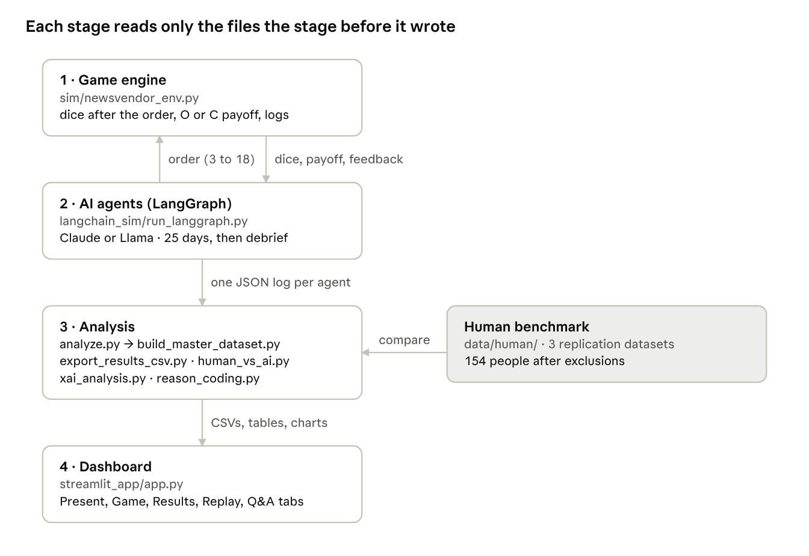

# GP3 Code Walkthrough: AI Agents in the Newsvendor Payment-Scheme Experiment

MBAN 5640 Group Project 3 · Dale, Krishna and Michael · November 2026

## 1. Overview

The project is one pipeline in four stages: a **game engine** plays the newsvendor game, **LangGraph agents** (Claude Haiku 5.5 or Llama 3.1) make the daily decisions, **analysis scripts** turn the saved logs into datasets, tests and charts, and a **Streamlit dashboard** presents everything. Each stage reads files the previous stage wrote, so any stage can be re-run on its own.



The agent and the engine talk once per day for 25 days; only after that does anything reach the analysis, which also reads the human data.

The walkthrough follows that order. Every section names the file, what it does, the key code, and the design choice behind it.

| Folder / file | Role | Writes |
| --- | --- | --- |
| `sim/newsvendor_env.py` | Game engine: dice, payoffs, prompts, logging | `data/state_*/A##.json` |
| `sim/setup_agents.py`, `sim/prompt_variants.py` | The study's instructions and the three alternative wordings | `prompts*/A##.txt` |
| `langchain_sim/run_langgraph.py` | The AI agents: LangGraph loop, Claude API or Ollama | one JSON log per agent |
| `analysis/analyze.py` | One run: compile, validate, test, plot | `data/ai_agent_*{tag}.csv`, `analysis/results{tag}.json` |
| `analysis/build_master_dataset.py` | Stack all runs (Deliverable B) | `data/ai_dataset_all_*.csv` |
| `analysis/export_results_csv.py`, `variant_comparison.py` | O vs C per run; variant vs base | `results_summary.csv`, `results_vs_base.csv` |
| `analysis/human_vs_ai.py` | Formal human-vs-AI tests and the two main charts | `human_vs_ai_table.csv`, `fig_gap_ci.png`, `fig_human_vs_ai_days.png` |
| `analysis/xai_analysis.py`, `reason_coding.py` | Why: Shapley values; the agents' own reasons | `xai_results*.json`, `reason_codes_*.csv` |
| `streamlit_app/app.py` | Presentation dashboard | (reads everything above) |
| `data/human/` | The three human replication datasets | (input) |

## 2. The game engine: `sim/newsvendor_env.py`

The engine is the referee. The AI never computes its own profit or rolls its own dice; it only says a number, and this file does everything else. That keeps the rules identical for every agent and makes every decision checkable.

**Constants.** One line fixes the experiment exactly as in the paper:

```python
ROUNDS, START_CASH, QMIN, QMAX, PRICE, COST = 25, 100, 3, 18, 2, 1
rng = random.SystemRandom()          # operating-system randomness for the dice
```

**State.** Each agent is one JSON file (`data/state_*/A07.json`) holding `id`, `cond` (O or C), `cash`, the list of `rounds` and the `debrief`. Because the state lives on disk, a crashed run can resume exactly where it stopped.

**`prompt(s)`** builds the start-of-day message: the day number, current play dollars, a reminder of when the 1 play dollar moves, and the question *How many units would you like to order? (whole number from 3 to 18)*.

**`play(s, q)`** is the heart of the file. It rolls three dice *after* the order, so the agent cannot influence demand, then applies the payoff rule of the agent's scheme:

```python
d1, d2, d3 = (rng.randint(1, 6) for _ in range(3))
demand = d1 + d2 + d3
sold, left = min(q, demand), max(q - demand, 0)
change = (PRICE*sold - COST*q) if s["cond"] == "O" else (COST*q - PRICE*left)
```

The two formulas are algebraically identical (2·sold − q = q − 2·leftover), which is the whole point of the study: the schemes differ only in *timing* and *wording*. Every round is saved with the order, the three dice, demand, sold, leftover, change and closing cash.

**Faithful mode** (`NV_FAITHFUL=1`, or `--faithful` in the runner) was added after review. The main runs printed a daily net line, `Change in play dollars today: +4`, and called C's money "an advance payment". Humans never saw a net number, so faithful mode drops that line and uses the study's wording ("a profit of 1 play dollar"). The default reproduces the original runs exactly, so existing data stay valid.

**Command-line interface.** `init`, `status`, `order` and `debrief` let an agent play through shell commands; this is how the first (archived) Claude Sonnet run worked. The LangGraph runner imports `prompt()` and `play()` directly instead, so both routes share one rulebook.

## 3. Instructions and wordings: `sim/setup_agents.py` and `sim/prompt_variants.py`

The agents read the study's own instructions, word for word, and nothing else: no persona, no age or major, no hint about the optimum. These two files hold that text.

**`setup_agents.py`** stores `INSTR`, a dictionary with the O and C game instructions copied from the in-person instruction sheets. The two texts differ only in two bullets:

| Bullet | O (own financing) | C (customer financing) |
| --- | --- | --- |
| At order time | −1 per unit ordered: "you pay 1 play dollar" | +1 per unit ordered: "you receive a profit of 1 play dollar" |
| After demand | +2 per unit sold | −2 per unit unsold (penalty) |

It also writes one briefing file per agent (`prompts/A01.txt` … `A50.txt`) and an initial state file. Assignment is 25 O and 25 C, shuffled with seed 2026 so the same agent ID gets the same scheme in every wording. That makes "v1 C vs base C" a like-for-like comparison.

**`prompt_variants.py`** holds the three robustness wordings, and `get_instr(variant, base)` returns the right pair:

- **v1** – a customer story ("each customer will pay you 1 play dollar… you pay back 2 dollars for each unsold widget").
- **v2** – adds bankruptcy warnings ("you will be BANKRUPT… the experiment will end in FAILURE"). The warning is shown but not enforced; 25 days from 100 play dollars cannot realistically reach bankruptcy.
- **v3** – the study's text with one change: the incentive is extra API token spend instead of real dollars. `strip_bonus()` removes the human $5 bonus paragraph for this variant.

Only the C texts of v1 and v2 were supplied; the O texts were drafted by flipping the payment direction. The file says so in its header, and the report lists it as a limitation.

## 4. The AI agents: `langchain_sim/run_langgraph.py`

This file turns a language model into an experiment participant. Each agent is one independent conversation that plays 25 days in a LangGraph loop and is then debriefed; agents never see each other.

**System prompt.** `SYSTEM` is a `ChatPromptTemplate` that frames the model as a paid lab participant ("you are not an AI assistant"), adds the study's $5 + bonus paragraph and inserts the O or C instructions from section 3. It ends with *Answer each day with only your order quantity.*

**Structured output.** The model cannot reply in free text; it must fill a Pydantic schema, and LangChain re-asks automatically if the answer is invalid:

```python
class Decision(BaseModel):
    order: int = Field(ge=3, le=18, description="Units to order today (whole number 3-18)")

class Debrief(BaseModel):
    followup_order: int   # "If you could play again choosing only one order quantity..."
    check_answer: int     # order 10, demand 7 -> change in balance? (correct: +4)
    range_min: int        # lowest possible demand (correct: 3)
    range_max: int        # highest possible demand (correct: 18)
    strategy: str         # one sentence on how it decided
```

**Memory.** The graph state carries `messages`, the full conversation. Each day appends the agent's order (`I order 10 units.`) and the engine's feedback, and the whole history is sent with the next decision. The agent therefore sees every earlier day, as a human participant would.

**The graph.** Three nodes and one conditional edge:

```python
g.add_node("decide", decide)     # model -> Decision(order)
g.add_node("play", play)         # env.play(): dice, payoff, feedback message
g.add_node("debrief", debrief)   # model -> Debrief(...)
g.set_entry_point("decide"); g.add_edge("decide", "play")
g.add_conditional_edges("play", lambda s: "decide" if len(s["sim"]["rounds"]) < 25 else "debrief")
```

**Two models, one code path.** `make_llm()` returns `ChatOllama` for Llama 3.1 8B (free, local, temperature 1.0) or `ChatAnthropic` for Claude Haiku 5.5. Claude no longer accepts a temperature setting, so none is sent; the API then samples at its default of 1.0, the same as Llama.

**Running many agents safely.**

- `ThreadPoolExecutor(workers)` runs several agents in parallel. Too many workers can hit the API rate limit (500,000 input tokens a minute on our account); 2–3 workers is safe.
- **Resume:** an agent whose JSON already has a debrief is skipped, so re-running the same command only redoes failed agents.
- One agent's error is caught and printed as `FAILED`, so it never stops the batch.
- Each run is tagged for LangSmith (agent, scheme, model, wording) when `LANGSMITH_TRACING=true`.

**Switches.**

| Flag | Effect | Output folder |
| --- | --- | --- |
| `--provider anthropic\|ollama`, `--model` | Which model | `state_api_haiku_5_5*` or `state_langchain*` |
| `--variant base\|v1\|v2\|v3\|all` | Which wording | suffix `_v1` … |
| `--n 50`, `--workers 5`, `--limit 2` | Agents per wording, parallel agents, test run | |
| `--faithful` | Human-like feedback (section 2) | suffix `_faithful` |
| `--reasons` | Order first, then one sentence on why, saved per day | suffix `_reasons` |

## 5. One run at a time: `analysis/analyze.py`

`analyze.py` processes one run folder, chosen with two environment variables: `AI_STATE_DIR` (which folder of agent logs) and `AI_TAG` (the suffix for its output files, e.g. `_faithful`). It works in five steps.

1. **Compile.** Reads every `A##.json`, skips incomplete agents (fewer than 25 days or no debrief), and scores the two checks: profit answer = 4, and range = 3 and 18. It writes three tables: `ai_agent_long{tag}.csv` (one row per agent-day), `ai_agent_participants{tag}.csv` (one row per agent, with check answers, follow-up answer, strategy, final cash) and `ai_agent_wide{tag}.csv` (one row per agent with `order1`…`order25`, the same layout as the human files, so the replication team's R script also runs on it).
2. **Validate.** Counts orders outside 3–18, missing values, rows where demand ≠ sum of dice, and payoff-rule violations, and reports mean demand (should be about 10.5). Every run so far has zero violations.
3. **Load the human data.** The three replication CSVs in `data/human/`, with comprehension failures removed, plus the original Duke numbers typed in from the paper (its raw data are not public).
4. **Test O vs C.** `summarise()` takes each participant's 25-day average and runs the paper's test (pooled-variance t-test, equivalent to its OLS on a condition dummy), plus a clustered-standard-error regression on every single order, a Mann-Whitney test, Cohen's d and a confidence interval.
5. **Diagnose and plot.** Share of orders at 10–11, within-agent spread, early vs late days, mean profit by scheme; then `fig_comparison{tag}.png` and `fig_distributions{tag}.png`.

The clustered regression matters because one participant's 25 orders are not 25 independent observations. Clustering by participant widens the standard errors to account for that, matching R's `vcovCL(type = "HC1")` used by the replication team:

```python
V = XtXi @ meat @ XtXi * (G/(G-1)) * ((n-1)/(n-k))   # meat = sum over participants of (X'e)(X'e)'
```

## 6. Combining runs: `build_master_dataset.py`, `export_results_csv.py`, `variant_comparison.py`

Once each run has its own CSVs, three small scripts put them side by side.

**`build_master_dataset.py`** produces Deliverable B. It loops over both models and the wordings base, v1, v2, v3 and faithful (skipped if that run doesn't exist), adds `model` and `wording` columns, and stacks everything into `data/ai_dataset_all_long.csv` (11,250 decisions) and `data/ai_dataset_all_participants.csv` (450 agents). `DATA_DICTIONARY.md` documents every column.

**`export_results_csv.py`** reads the raw JSON logs again and writes two tables:

- `results_summary.csv` – for every model × wording, the O and C means, the gap, a Welch p-value and Cohen's d, in three subsets: all agents; **passed range check (original rule)**, the primary analysis; and passed both checks, kept as secondary because Claude fails the profit check more often in C (72%) than in O (57%), which would bias the comparison.
- `results_vs_base.csv` – each wording against the base wording *within the same scheme* (v1 O vs base O, v1 C vs base C). A variant C is never compared with a base O, which would mix the wording effect with the scheme effect.

**`variant_comparison.py haiku|llama`** prints the same within-scheme comparison to the screen for one model, with an optional `--passed-only` filter. It is the quick check to run after a new wording.

## 7. Human vs AI: `analysis/human_vs_ai.py`

This script answers the research question formally: is the AI's O−C gap different from the human gap? It reads the master dataset and the three human files, and produces one table and the two headline charts.

**Samples.** Humans = the three replications with comprehension failures removed (154 people), plus the original Duke study from its published summary. AI = every model × wording, applying the **original exclusion rule**: an agent is dropped only if it got the dice range (3 and 18) wrong. That drops 6 Llama agents in the base wording and no Claude agents.

**Per sample, `describe()` computes:**

- the O−C gap of participants' 25-day averages, with a 95% confidence interval (Welch) and the paper's pooled-variance p-value;
- the round-1 gap (the one decision not shaped by feedback) and, where asked, the follow-up-question gap;
- within-participant spread, spread between participants, and the share of orders at 10–11.

**The key test, `interaction()`.** Each AI run is pooled with all human orders and one regression is fitted on every single order:

```latex
\text{order}_{it} = \beta_0 + \beta_1 O_i + \beta_2 AI_i + \beta_3 (O_i \times AI_i) + \varepsilon_{it}
```

β₁ is the human O−C gap and β₃ is how much the AI gap differs from it. A negative, significant β₃ means the AI shows *less* of the bias than people. Standard errors are clustered by participant with the same `ols_cluster()` function (CR1, as in R). For Claude in the study's wording β₃ = −1.12 (p < 0.001).

**Outputs.**

- `analysis/human_vs_ai_table.csv` – one row per sample with every number above; the dashboard and report read from it.
- `analysis/fig_gap_ci.png` – the O−C gap with its 95% CI for every human and AI sample, the pooled human interval shaded: the main results slide.
- `analysis/fig_human_vs_ai_days.png` – average order by day, in small multiples: humans, Claude, Claude with human-like feedback, Llama.

The run named `faithful` in the data files appears as "human-like feedback" on the charts.

## 8. Explaining behaviour: `xai_analysis.py` and `reason_coding.py`

The tests say *whether* the agents differ from people; these two scripts say *why*, once from the decisions and once from the agents' own words.

**`xai_analysis.py` – what drives the next order?** It builds a dataset of consecutive decisions with features available for both humans and agents: `cond_O` (scheme), `day` and `prev_order`. The human files have no dice, so `prev_demand` and `prev_change` are added only in an extended AI model. Two models are fitted:

- an interpretable **OLS** with clustered standard errors, giving one coefficient per feature;
- a **gradient-boosting** model, explained with **exact Shapley values**: for each decision, every subset of features is evaluated against a background sample, and each feature gets its average marginal contribution (the procedure from Lecture Note 03).

Cross-validation is grouped by participant (`GroupKFold`), so the model is always tested on people or agents it has never seen. Result: the scheme explains about 17% of the Shapley importance for people, 2–3% for Claude and about 6% for Llama; both people and Claude mostly follow their own previous order. Run it once per model (`AI_TAG=_langchain` for Llama).

**`reason_coding.py` – what do the agents say?** It codes the agents' text into seven reason categories with transparent keyword rules (regular expressions), one flag per category:

| Category | Example trigger words |
| --- | --- |
| Average demand | average, expected, 10.5, typical, centers |
| Order-time payment | per unit ordered, upfront, in advance, at order time |
| Leftover / penalty risk | leftover, unsold, penalty, waste, over-order |
| Lost sales | lost sales, missed, not enough, run out |
| Trade-off | balance, trade-off, between |
| Recent demand | last, previous, recent, adjust |
| Explicit profit calculation | expected profit, margin, critical, probability |

With no argument it codes the end-of-game strategy sentence of every agent in every run; given a `--reasons` run folder, it codes the sentence attached to every single order. It prints the share of agents mentioning each reason by model, wording and scheme, plus two examples per category so the rules can be spot-checked. The headline: only 5 of 450 agents mention the order-time payment that the theory is about.

## 9. The dashboard: `streamlit_app/app.py`

The dashboard is the presentation. It calls no model and needs no API key: it only reads the files the earlier stages wrote, so every number on screen is the same number as in the report.

**Loading data.** `load_all()` runs once (cached with `@st.cache_data`) and reads the human CSVs, each AI run's wide/long/participant files (Claude base, Claude faithful, Llama base), `human_vs_ai_table.csv`, the master participants file and the JSON results. For each AI run it keeps two versions: `wide` applies the original exclusion rule (used by every statistic) and `wide_all` keeps every agent (used by the replay tab).

**Small helpers do the rest.** `kpis()` computes the headline gaps; `cmp_row(sample)` fetches one row of the comparison table; `load_wording()` assembles the robustness rows with failure counts from `results_summary.csv`; `reason_shares()` imports the rules from `reason_coding.py` and codes the strategy sentences live. Charts are Altair, drawn from the same rows.

**Tabs.**

| Tab | What it shows |
| --- | --- |
| Present | The 10-step guided talk: one step per screen, a timer and speaker notes. Step numbers match the presentation script. |
| Game | The newsvendor game itself, playable, with a "same day in the other wording" view proving the profit is identical |
| AI system | How the agents are built: the original-vs-AI settings table, the exact prompt, the models, validation checks, the dataset |
| AI replay | Step through any saved agent's 25 days and read its strategy sentence |
| Results | KPI row, the gap chart with 95% CIs, the statistics table with the formal human-vs-AI test, behaviour and reasons |
| Prompt wording | Every wording for both models, within-scheme comparisons, caveats |
| Q&A | Likely questions with short answers |
| Checklist | Each assignment deliverable and task mapped to where it is |

**Presenter mode.** Add `?presenter=1` to the address on the presenting laptop to show the notes and the timer; the audience view hides them. Step timings add up to 600 seconds (10 minutes).

**When results change,** nothing in the app needs editing: re-run the analysis (section 10) and restart the app. The only hand-written result text is `analysis/verdict.json`, the headline and verdict shown on the Results tab.

## 10. Running it, and questions to expect

All commands run from the project folder in PowerShell with the virtual environment active.

1. **Set up once:** `python -m pip install -r requirements.txt`, then put `ANTHROPIC_API_KEY=` (and optionally the LangSmith keys) in `.env`. The `.env` file is git-ignored.
2. **Test with two agents:** `python langchain_sim\run_langgraph.py --limit 2`
3. **Run the agents** (resumable; re-run the same command to finish failed agents):
    - Claude, all wordings: `python langchain_sim\run_langgraph.py --variant all --n 50 --workers 3`
    - Claude, human-like feedback: `python langchain_sim\run_langgraph.py --faithful --n 50 --workers 3`
    - Llama: `python langchain_sim\run_langgraph.py --provider ollama --model llama3.1:latest --variant all --n 50 --workers 2`
4. **Analyse each run:** `$env:AI_STATE_DIR="data\state_api_haiku_5_5_faithful"; $env:AI_TAG="_faithful"; python analysis\analyze.py` (the README lists the loop over all nine runs), then `Remove-Item Env:AI_STATE_DIR, Env:AI_TAG`.
5. **Combine and compare:** `python analysis\build_master_dataset.py`, `python analysis\export_results_csv.py`, `python analysis\human_vs_ai.py`.
6. **Explain:** `python analysis\xai_analysis.py` (and with `$env:AI_TAG="_langchain"` for Llama), `python analysis\reason_coding.py`.
7. **Present:** `python -m streamlit run streamlit_app\app.py`, with `?presenter=1` on the presenting laptop.

**Code questions likely in Q&A**

- **Can the agent cheat on the dice or the payoff?** No. It only returns a number; the engine rolls the dice after the order and computes the payoff, and `analyze.py` re-checks every row (0 violations).
- **Does each agent remember earlier days?** Yes. The whole message history is sent with every decision, so day 20 sees days 1–19.
- **Are the agents independent?** Each is a separate conversation with no shared memory, but all 50 come from the same model, so they are not 50 independent minds. We say this in the limits.
- **Why structured output instead of free text?** It guarantees a whole number from 3 to 18 and removes parsing errors; invalid answers are re-asked automatically.
- **Why cluster standard errors?** One participant's 25 orders are correlated, so treating them as 25 independent observations would overstate significance. Clustering by participant fixes that, the same way the replication team did in R.
- **Is it reproducible?** The code, prompts, seeds for scheme assignment and every raw log are in the repository, and every result can be rebuilt from the logs. The dice use operating-system randomness and a hosted model can change between dates, so a fresh run gives similar, not identical, numbers; that is why the logs are kept.
